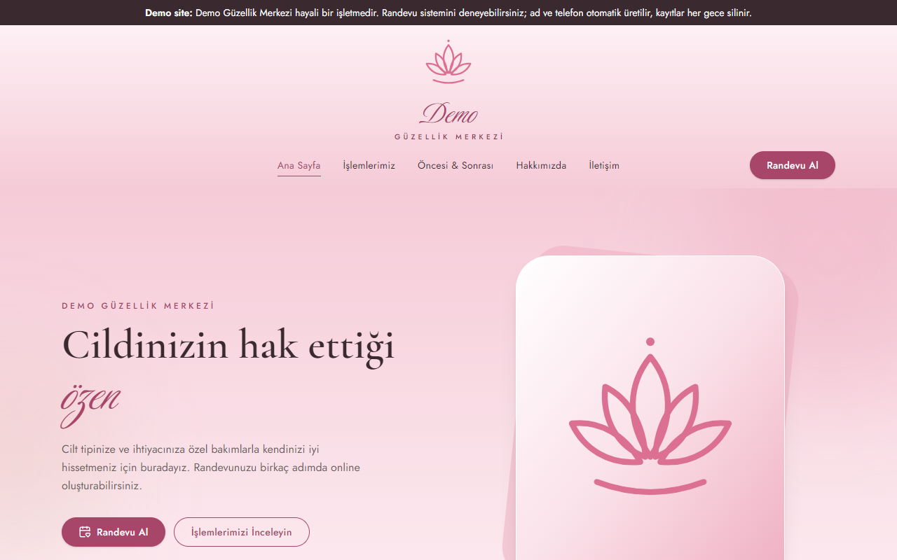
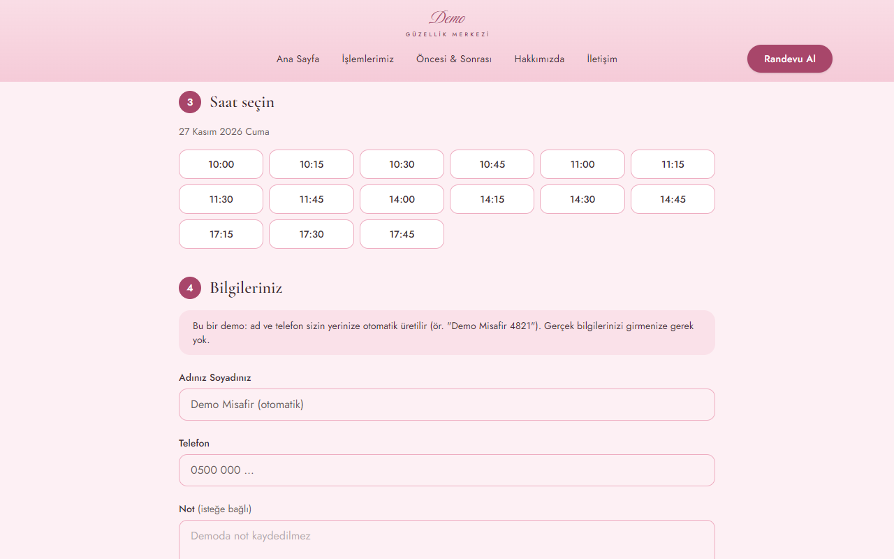
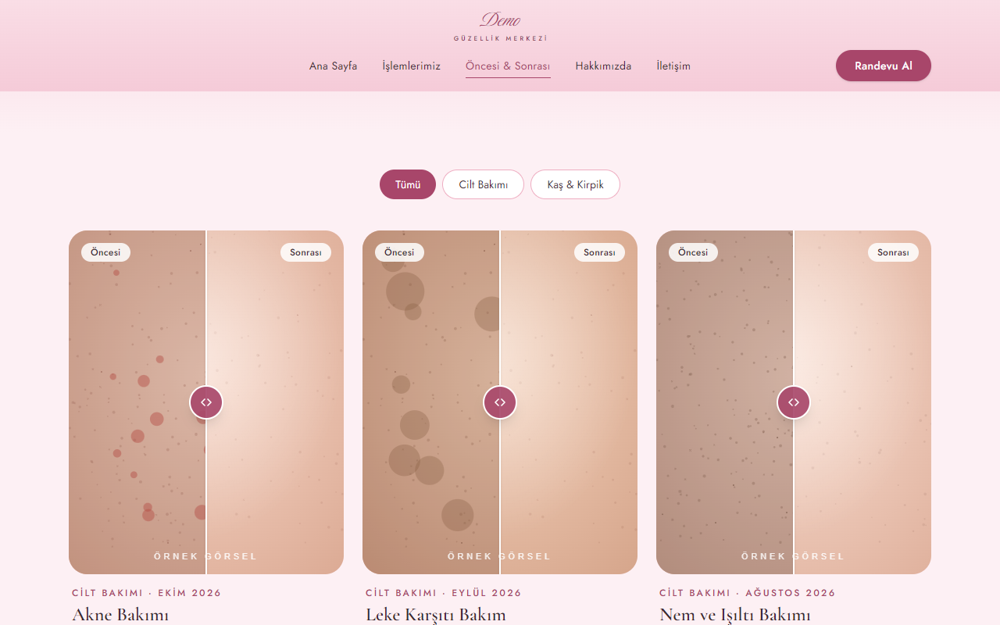
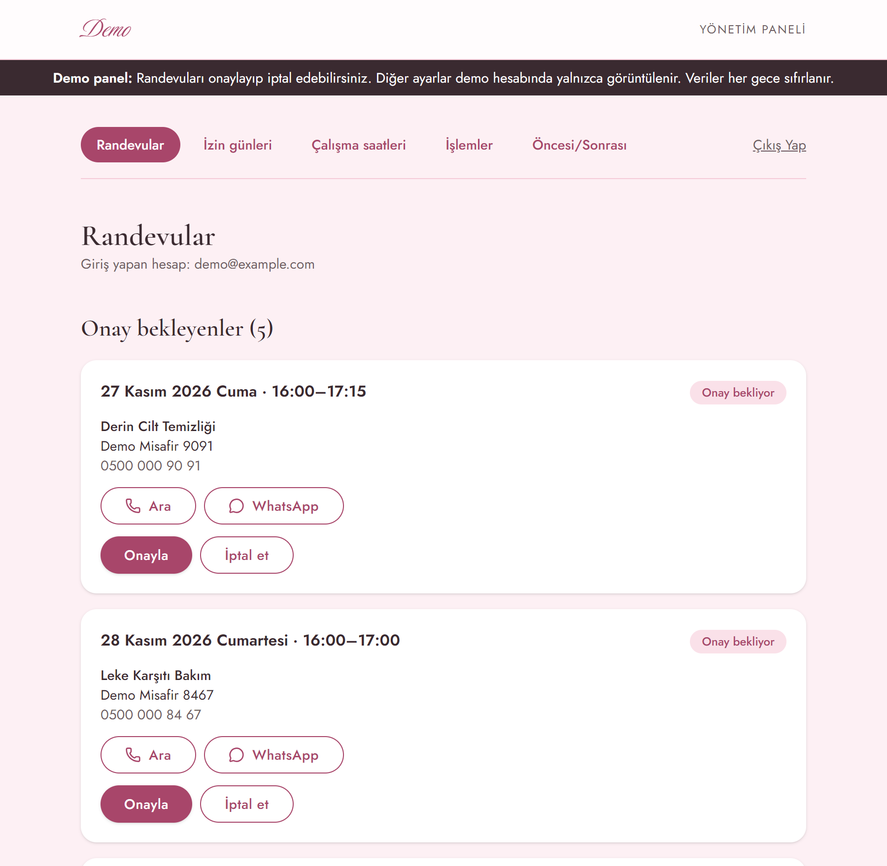
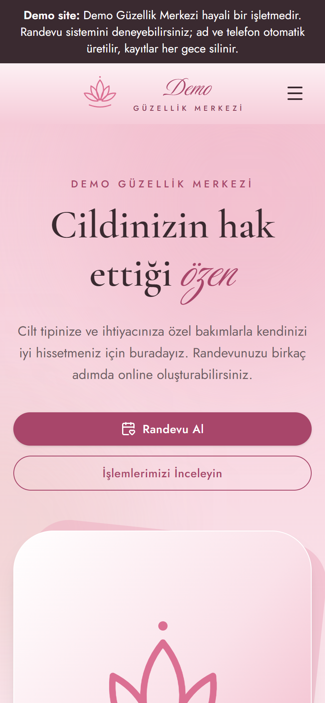
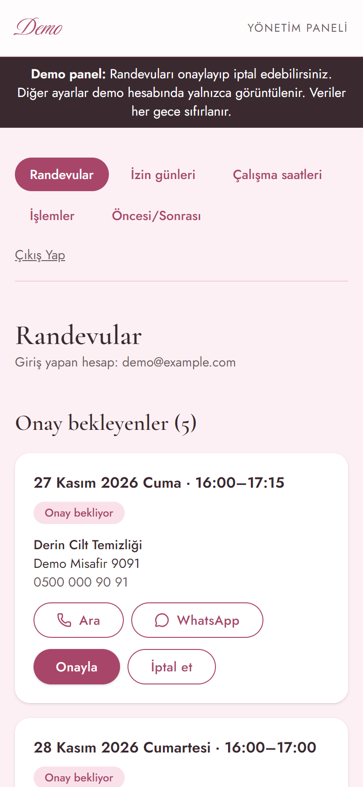
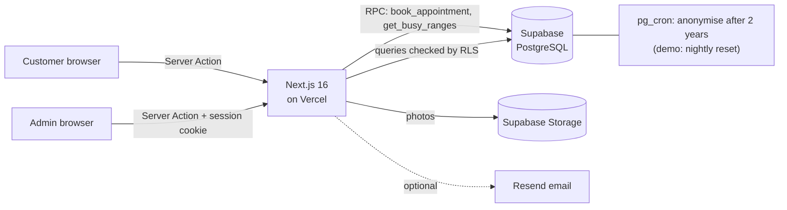

# Beauty Center Booking

**An online booking system and admin panel for a small beauty salon, built with Next.js 16 and Supabase (PostgreSQL).**
Visitors pick a treatment, a day and a free time slot. The salon owner approves or cancels requests from a phone-friendly admin panel, and also manages treatments, opening hours, days off and a before/after gallery there.

> 🔗 **Live demo:** [beauty-center-booking-five.vercel.app](https://beauty-center-booking-five.vercel.app) · 🇹🇷 [Türkçe özet aşağıda](#türkçe-özet)



The interface is in Turkish because the target users are Turkish salons. The code comments are in Turkish as well. I wrote this project while learning, so most comments explain *why* something is done, not just what.

---

## Try it in 30 seconds

| | What to do | What happens |
|---|---|---|
| 💇 **As a customer** | Open the demo → **Randevu Al** → pick a treatment, a day and a time | The booking is written to the real PostgreSQL database. The time slot immediately shows as taken for everyone. |
| 🔐 **As the salon owner** | Go to `/admin` → click **Demo olarak gir** (no password) | You get the real admin panel with sample appointments. Approve or cancel them, and look around the settings. |

The demo is designed so that **no personal data is ever collected**, even though it uses a real database:
- The server generates the name and phone number ("Demo Misafir 4821"). Whatever you type is ignored.
- A database trigger enforces the same rule a second time.
- Everything resets every night.

---

## Screenshots

| Booking: only free slots are offered | Before / after gallery with drag sliders |
|---|---|
|  |  |

| Admin panel: appointment requests | On a phone (customer site and admin panel) |
|---|---|
|  |   |

---

## Features

**For customers**
- A 4-step booking flow: treatment → day → time → details. The URL holds every step (`?islem=…&tarih=…`), so the back button and shared links just work.
- Free slots are calculated from opening hours, days off, existing bookings and the treatment's duration, on a 15-minute grid with at least 1 hour of notice.
- Treatment pages with prices, durations and "suitable for" lists.
- A before/after gallery with a draggable comparison slider and category filters.
- SEO basics: sitemap, robots, a generated Open Graph image, and `LocalBusiness` structured data.

**For the salon owner**
- Approve or cancel requests, and call or WhatsApp the customer in one tap.
- Manage treatments: create, edit, hide, set prices and featured items.
- Weekly opening hours and one-off days off (holidays, vacations).
- Upload before/after photos straight from an iPhone. Photos are resized in the browser and their location data is stripped.
- An optional email for each new booking, sent through Resend.

---

## The interesting parts

Most of the work was not in drawing pages. It was in the edge cases a real business would hit. Here are the problems I enjoyed solving most.

### 1. Two people book the same slot at the same second
The obvious approach is "check if the slot is free, then insert", which has a race condition: two requests can both see "free" and both insert. A `unique(starts_at)` constraint isn't enough either, because 14:00–15:30 and 14:30–16:00 start at different times but still overlap.

The fix is to let PostgreSQL enforce it with an **exclusion constraint** on time ranges:

```sql
constraint appointments_no_overlap
  exclude using gist (tstzrange(starts_at, ends_at) with &&)
  where (status <> 'cancelled')
```

- `[start, end)` is half-open, so 14:00–15:00 and 15:00–16:00 don't clash.
- Cancelled bookings free their slot.
- The admin can't create a double booking either, for example by re-approving a cancelled appointment whose slot was taken in the meantime.

### 2. Never trust the browser
Visitors can't write to the `appointments` table at all. They call a `security definer` function, `book_appointment`, which re-checks everything itself:
- It calculates the **end time** from the treatment's duration, so it never trusts one sent by the client.
- It checks the 15-minute grid, opening hours (in Istanbul time), days off, the 60-day horizon and field lengths.

The Server Action in front of it validates again with **zod**. That check is for friendly error messages. The database check is the one that counts.

### 3. Showing busy slots without leaking who booked them
The booking page needs to know which times are taken, but customer names and phones are personal data. A dedicated function, `get_busy_ranges(day)`, returns **only start and end times**: no names, no phones, not even which treatment. Anyone can call it from the browser console, and that's fine, because there is nothing in it to leak.

### 4. Spam protection that can't be bypassed
- **Honeypot:** the form has a hidden field that bots fill in and humans never see.
- **Trigger:** a `before insert` trigger on `appointments` applies two limits, whichever path the insert comes from:
  - at most **20 requests per hour** overall;
  - at most **3 upcoming bookings per phone number**, with phones normalised to digits and backed by an expression index.

### 5. "Logged in" is not "admin"
Supabase gives every signed-in user the `authenticated` role. On top of that, admins live in a separate `admins` table that nobody can read through the API, checked by `is_admin()`. Row-level security uses that function, and **column-level grants** mean the admin can update only an appointment's `status`, never the customer's name or time.

### 6. Letting strangers into the admin panel, safely
For this portfolio version I wanted recruiters to see the admin side too, not just screenshots. The **Demo olarak gir** button signs you in as a shared demo account. The server holds the credentials, so they never reach the browser.

A shared admin session is dangerous, though. Anyone can copy the session cookie and talk to Supabase directly, skipping my server entirely. So the server-side "Demoda kapalı" message is only the polite layer. The real lock is in the database:
- **`RESTRICTIVE` RLS policies** are AND-ed with the existing admin policies: *admin **and** not the demo account*. They cover treatments, hours, days off, the gallery and photo storage.
- **A trigger on `auth.users`** keeps the demo account's password and email from being changed, so nobody can lock everyone else out.
- **Appointments** stay open, so approving and cancelling still works.

I verified this by impersonating the demo user inside PostgreSQL (`set local role authenticated` plus JWT claims). It passed `is_admin()` and was still able to update **0 rows**.

### 7. A real database with zero personal data
The demo writes real rows, so the exclusion constraint, the RPC and the rate limits all run for real. But the name, phone and note are replaced twice:
1. in the Server Action (`demoIdentity()`);
2. in a database trigger, in case someone calls the RPC directly.

Triggers fire in alphabetical order, so the trigger is named `appointments_a_demo_identity` to make it run **before** the rate-limit trigger. A `pg_cron` job wipes the table every night and seeds believable sample appointments for the coming week. It skips closed days and days off, and mixes pending, confirmed and cancelled statuses.

### 8. Privacy by design (KVKK, Turkey's GDPR)
- A nightly `pg_cron` job **anonymises appointments older than two years**: name, phone and note are removed, while treatment and date are kept for statistics.
- Photos are re-encoded through a `<canvas>`, which drops EXIF data. GPS coordinates in a phone photo never reach the server.
- The privacy notice page is generated from the same config file as the rest of the site.

### 9. Small things that took longer than expected
- **Time zones:** the server runs in UTC and the salon in Istanbul. All conversion happens in one small, fully tested module (`istanbulTime.ts`).
- **iPhone uploads:** Safari can't encode WebP from a canvas (it silently returns a large PNG), so photos are saved as JPEG. HEIC files that a desktop browser can't decode show a clear error.
- **Caching:** the app uses Next 16 `cacheComponents`. Treatments, hours and days off are cached and tagged, and the admin's save calls `updateTag(…)`, so changes appear instantly. Busy slots are never cached.
- **Security headers:**
  - a Content Security Policy;
  - `frame-ancestors 'none'` against clickjacking;
  - HSTS;
  - a `X-Robots-Tag: noindex` header on every non-production deploy.

---

## Architecture



| Layer | Choice | Why |
|---|---|---|
| Framework | **Next.js 16** (App Router, Server Actions, `cacheComponents`), React 19, TypeScript | Server-rendered pages, and forms that work without client-side API code |
| Database | **Supabase PostgreSQL**: RLS, `security definer` RPCs, triggers, exclusion constraint, `pg_cron` | Business rules live next to the data, so every path into the database obeys them |
| Auth | Supabase Auth with `@supabase/ssr` cookies; a Next 16 `proxy.ts` refreshes the session | |
| Validation | **zod 4** | Same rules on the server, readable Turkish error messages |
| Styling | **Tailwind CSS 4** with brand colours as theme tokens | Rebranding means changing one block |
| Tests | **Vitest**, 130 tests | |
| Hosting | Vercel, with the database in the EU (Ireland) | |

**One codebase, three modes.** `SITE_MODE` switches between:
- **`production`:** the real salon site.
- **`staging`:** noindex, a "trial version" banner, and only bookings named `TEST…` are accepted.
- **`demo`:** this portfolio. A typo in the value stops the build on purpose, so a mistyped demo can never quietly start collecting real data.

<details>
<summary><b>Project structure</b></summary>

```
src/
  app/(site)/        public pages: home, treatments, booking, gallery, about, contact, privacy
  app/admin/         admin panel: appointments, days off, hours, treatments, gallery, login
  components/        UI pieces (header, slider, cards, banners…)
  data/              database reads, cached and tagged
  lib/               pure logic + tests: slots, time zone, phone, validation rules, site config
  proxy.ts           session refresh + login redirect for /admin
supabase/
  migrations/        0001–0015, run in order on a new project
  seed.sql           sample treatments and gallery items
  demo/              demo-only SQL (identity trigger, nightly reset, demo admin): never on a real salon
docs/
  YENI-MUSTERI.md    step-by-step checklist for setting the site up for a new salon (Turkish)
```
</details>

---

## Tests

```bash
npm test          # Vitest: 130 tests in 20 files
```

All the logic that is easy to get subtly wrong lives in **pure functions** with no database and no framework, so it can be tested directly:
- free-slot calculation, overlaps, and hiding times that have already passed;
- Istanbul time conversion across midnight;
- which days are bookable;
- phone normalisation;
- opening-hours and treatment validation rules;
- days-off ranges;
- image resize maths;
- storage paths;
- redirect rules for the admin area;
- site-mode parsing;
- the demo identity generator and the demo admin check;
- mapping database error codes to user-facing messages.

---

## Running it locally

You need Node 20+ and a free Supabase project.

```bash
git clone https://github.com/0Ens/beauty-center-booking.git
cd beauty-center-booking
npm install
cp .env.example .env.local     # fill in your Supabase URL and publishable key
```

1. In the Supabase dashboard, enable the **pg_cron** extension. Then, in the SQL Editor, run `supabase/migrations/0001…0015` in order, followed by `supabase/seed.sql`.
2. Create an admin user under *Authentication → Users*, add it to the `admins` table, and turn off public sign-ups.
3. Start the app:

   ```bash
   npm run dev                    # http://localhost:3000, admin at /admin
   ```

Every variable is explained inside [`.env.example`](.env.example).

### Setting it up for a new salon
Everything specific to the salon is kept in a few places:
- **[`src/lib/site.ts`](src/lib/site.ts):** name, contact details, address, texts and privacy-notice details.
- **The brand colours block** in `globals.css`.
- **The fonts block** in `layout.tsx`.
- **The logo SVG.**

Treatments, prices, hours and photos are managed from the admin panel. The full checklist, covering a new Supabase project, hosting, domain, email and the legal review, is in **[docs/YENI-MUSTERI.md](docs/YENI-MUSTERI.md)** (Turkish).

---

## About AI assistance

I built this project with **Claude Code**, Anthropic's AI coding assistant, as a pair-programmer. I set the requirements and made the product and design decisions, and I tested everything on real devices, including the iPhone the admin panel was built for. Much of the code was written in those sessions together with the AI. My goal was to learn while building, which is why the code is full of explanatory comments: they are the explanations I worked through for each concept, from exclusion constraints to RLS. I think it's fair to be upfront about this, and I'm happy to walk through any part of the code.

---

## License

Copyright © 2026 Enes Erul. **All rights reserved.** See [LICENSE](LICENSE).
The code is public so it can be read and evaluated. Please ask before reusing it.

---

## Türkçe özet

**Küçük bir güzellik salonu için online randevu sistemi ve yönetim paneli** (Next.js 16 + Supabase PostgreSQL).

**Ne yapıyor?**
- Müşteri işlemi, günü ve boş saati seçip randevu talebi gönderir.
- Salon sahibi telefonundan talepleri onaylar ya da iptal eder.
- İşlemleri, çalışma saatlerini, izin günlerini ve öncesi/sonrası galerisini de panelden yönetir.

**Öne çıkan teknik çözümler:**
- **Çift rezervasyon:** Veritabanındaki `exclude using gist` kısıtı ile engelleniyor; aynı saniyede gelen iki istekte bile.
- **Tarayıcıya güvenmeme:** Bütün kurallar `security definer` fonksiyonlarda yeniden kontrol ediliyor.
- **Spam freni:** Trigger ile saatte 20 talep ve numara başına 3 randevu sınırı var.
- **Yetkilendirme:** RLS ile; admin randevunun sadece durum sütununu değiştirebiliyor.
- **KVKK (kişisel verilerin korunması):** 2 yıl sonra otomatik anonimleştirme, fotoğraflardan konum bilgisinin silinmesi ve demoda kişisel veri hiç toplanmaması.

**Demo:** [beauty-center-booking-five.vercel.app](https://beauty-center-booking-five.vercel.app)
- Randevular gerçekten veritabanına yazılıyor, ama ad ve telefonu sunucu ve veritabanı uyduruyor. Kayıtlar her gece sıfırlanıyor.
- `/admin` sayfasındaki **"Demo olarak gir"** düğmesiyle şifresiz panele girilebiliyor. Randevu onaylama ve iptal açık; diğer ayarlar veritabanı seviyesinde RESTRICTIVE RLS politikalarıyla kilitli.

**Yeni bir salona uyarlamak:** Ayar dosyası, renkler ve logo değiştirilip yeni bir Supabase projesi kurulur. Adım adım rehber: [docs/YENI-MUSTERI.md](docs/YENI-MUSTERI.md).

Claude Code (yapay zeka) desteğiyle, öğrenerek geliştirildi.
